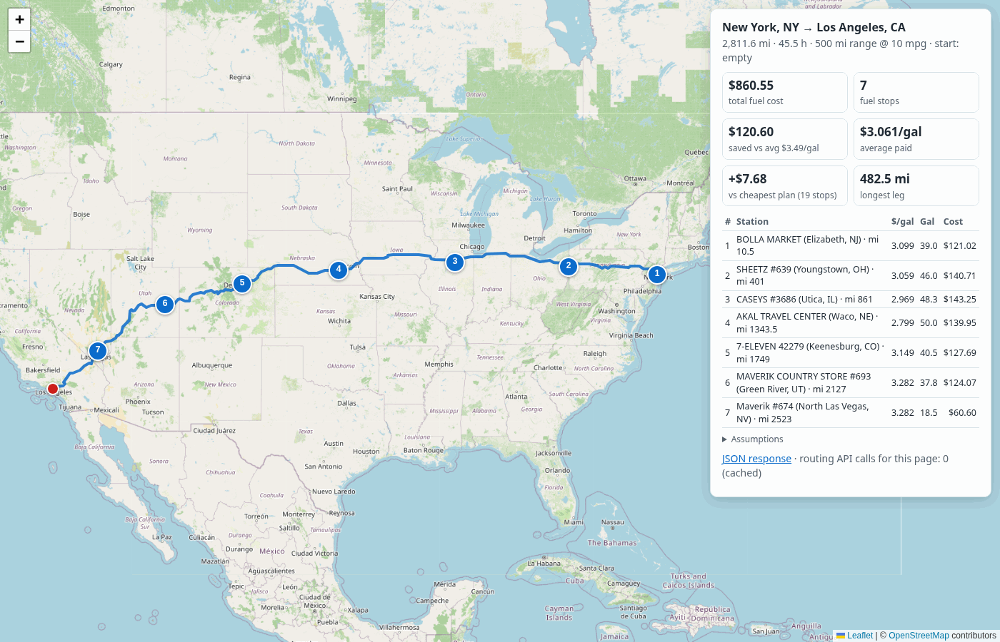

# Fuel Route Optimizer

> **TL;DR**
> - **What:** a Django 6.1 + DRF API. Give it two US locations, and it returns the route (GeoJSON + Leaflet map), cost-effective fuel stops for a 500-mile/10-mpg vehicle, and the total fuel cost.
> - **Run:** `pip install -r requirements-dev.txt`, `cp .env.example .env` (add a free ORS key), `python manage.py migrate && python manage.py load_stations && python manage.py runserver`, then open `/api/docs/`.
> - **NYC → LA (recorded route):** 7 stops, $860.57, which is $7.69 more than the 19-stop pure-cost optimum and $120.59 less than paying the corridor-average price.
> - **API calls and speed:** 1 routing call per new trip, 0 when cached; cached responses take 7–36 ms on gunicorn; 6,604 of 6,626 stations (99.67%) are geocoded offline or from a committed cache.
> - **Quality:** 400 tests, with the optimizer verified against a brute-force solver on 900 random instances; 17-request Postman collection; 21 ADRs.

A Django REST API that plans a driving route between two US locations and chooses **cost-effective fuel stops** along it. It uses the provided truck-stop price list, a vehicle with a 500-mile range at 10 mpg, and returns the route as GeoJSON plus an interactive map. A typical request makes **one** routing API call (OpenRouteService), and a repeated request makes **none**.

On the recorded New York → Los Angeles route (2,811.6 mi), the default plan makes **7 stops** and costs **$860.57**. That is $7.69 more than the 19-stop pure-cost optimum ($852.87), and $120.59 less than paying the corridor's average price.

## Features → requirements

| Requirement | How it is met |
|---|---|
| Start and finish inside the USA | Accepts `"City, ST"`, `"lat,lon"` or a US street address; anything else → 422 `location_outside_usa` |
| Map of the route | GeoJSON `FeatureCollection` (route line, start, finish, numbered stops) in the JSON, plus `map_url` → Leaflet/OpenStreetMap page |
| Optimal, cost-effective fuel stops | Pure cost: provably optimal greedy. Default: exact DP minimising *fuel cost + $15 per stop*. Both verified against a brute-force solver ([ALGORITHM.md](docs/ALGORITHM.md)) |
| 500-mile range, multiple stops | Tank = range ÷ mpg = 50 gal; no leg between fuel sources exceeds the range (`summary.largest_leg_miles`) |
| Total fuel cost at 10 mpg | `summary.total_fuel_cost`, per-stop gallons and cost, the pure-cost optimum, and savings vs the corridor's average price |
| Use the provided price file | Cleaned (US only, de-duplicated) and geocoded offline: 6,604 of 6,626 stations (99.67%) ([DATA_PIPELINE.md](docs/DATA_PIPELINE.md)) |
| Free map and routing API | OpenRouteService via the HeiGIT gateway for routing; OpenStreetMap tiles for the map |
| Fast | Stations and gazetteer in memory, KD-tree corridor search, three cache layers; cached response 7–36 ms ([Performance](#performance)) |
| Few routing API calls | 1 per new trip, 0 when cached, ≤ 3 with street addresses; reported in `meta.external_api_calls` |

## Tech stack

Python 3.12 · **Django 6.1.2** · Django REST Framework 3.18.3 · drf-spectacular 0.30.0 (OpenAPI/Swagger) · NumPy 2.5.4 · SciPy 1.18.1 (KD-tree) · requests 2.34.2 · django-environ 0.14.0 · SQLite · gunicorn 26.2.0 · pytest 9.1.1 · ruff 0.17.1

## Quickstart

```bash
git clone https://github.com/Jatin-1602/fuel-route-optimizer.git && cd fuel-route-optimizer
python3.12 -m venv .venv && source .venv/bin/activate
pip install -r requirements-dev.txt
cp .env.example .env            # then set ORS_API_KEY=… (free "Basic Key": https://account.heigit.org/manage/key)
python manage.py migrate && python manage.py load_stations
python manage.py runserver      # Swagger UI: http://localhost:8000/api/docs/
```

A fresh clone takes about a minute from `git clone` to a running server (about 50 s measured, plus ~45 s for `pytest -q`). The geocoded station data is committed, so setup needs no geocoding run. The API key is only needed for routing. More detail, including macOS/Windows notes and troubleshooting, is in [docs/SETUP.md](docs/SETUP.md).

## Example

```bash
curl "http://localhost:8000/api/v1/route/?start=Chicago,%20IL&finish=Houston,%20TX&include_geometry=false"
```

Response (trimmed; values from the recorded Chicago → Houston route):

```json
{
  "start":  {"query": "Chicago, IL", "name": "Chicago, IL", "lat": 41.83705, "lon": -87.68494, "resolved_by": "offline"},
  "summary": {
    "total_distance_miles": 1081.8, "number_of_stops": 3,
    "fuel_consumed_gallons": 108.18, "initial_fuel_gallons": 1.8, "gallons_purchased": 106.38,
    "initial_fuel_cost": 5.54, "total_fuel_cost": 319.53,
    "pure_cost_optimum": {"total_fuel_cost": 317.48, "number_of_stops": 8},
    "extra_cost_vs_pure_optimum": 2.05, "baseline_cost_at_avg_corridor_price": 357.27,
    "estimated_savings": 37.74, "largest_leg_miles": 475.5, "stop_penalty": 15.0
  },
  "fuel_stops": [
    {"order": 1, "name": "QUIKTRIP #7205", "city": "Lansing", "state": "IL", "mile_marker": 18.0,
     "price_per_gallon": 3.079, "gallons_purchased": 29.85, "cost": 91.91},
    {"order": 2, "name": "HUCKS FOOD & FUEL #379", "city": "Marion", "state": "IL", "mile_marker": 316.5,
     "price_per_gallon": 2.929, "gallons_purchased": 47.55, "cost": 139.27},
    {"order": 3, "name": "Quiktrip #7900", "city": "Texarkana", "state": "TX", "mile_marker": 792.0,
     "price_per_gallon": 2.857, "gallons_purchased": 28.98, "cost": 82.8}
  ],
  "route": null,
  "map_url": "http://localhost:8000/api/v1/route/map/?start=Chicago%2C+IL&finish=Houston%2C+TX&…",
  "meta": {"external_api_calls": 1, "external_api_attempts": 1, "cache_hit": false, "stations_considered": 179}
}
```

**How it adds up.**
- **Gallons:** 29.85 + 47.55 + 28.98 bought at the stops, plus 1.80 initial, equals **108.18**, which is 1,081.8 mi ÷ 10 mpg.
- **Money:** with the default `start_fuel=empty`, the 1.80 gal burned to reach stop 1 is charged at stop 1's price as `initial_fuel_cost`. So `total_fuel_cost` = stop costs + `initial_fuel_cost` = the cost of every gallon used on the trip. The other `start_fuel` modes are `full` and a number of gallons; see [API.md](docs/API.md).

> Note: every figure is rounded independently from unrounded values. Adding up rounded parts can therefore be a cent off: here 91.91 + 139.27 + 82.80 + 5.54 = 319.52, while the unrounded total of 319.5258 rounds to **319.53**. Deltas such as "+$7.69" (`extra_cost_vs_pure_optimum`) and savings are likewise computed from unrounded values, not from the rounded numbers shown.

## How many routing API calls?

| Request | `external_api_calls` |
|---|---|
| `"City, ST"` or `"lat,lon"` at both ends (resolved offline from the Census gazetteer) | **1** (directions) |
| The same request again (response cache) | **0** |
| The same trip with different vehicle parameters, e.g. `mpg`, `start_fuel` or `stop_penalty` (route cache) | **0** |
| Opening `map_url` after the JSON request | **0** |
| A free-text street address at one or both ends | **2–3** (one geocode per address, cached for 30 days, plus directions) |

`meta.external_api_attempts` additionally counts retries. Directions have a 30 s read timeout and geocoding 10 s. Either is retried once on a read timeout, and connection errors or 502/503/504 are retried up to twice ([ADR-009](docs/DESIGN_DECISIONS.md#adr-009--timeouts-and-retries-for-openrouteservice)).

> **The first long route can take 10–20 s** while OpenRouteService computes it. Repeats are cached and return in milliseconds. ORS also stalls occasionally, and the single retry usually recovers.

## Performance

Measured with `scripts/benchmark.py` against **gunicorn 26.2.0** (2 workers × 4 threads, `--preload`, `WARM_ON_STARTUP=1`) on 2026-10-18. Values are client wall time, p50, in ms ([raw output](docs/benchmarks/2026-10-18-gunicorn.md)):

| Route | Response | Cold (after `clear_cache`, 1 ORS call) | Warm-ORS (route cached, everything else recomputed) | Cached |
|---|---|---|---|---|
| NYC → LA (2,812 mi) | full, 171 KB | 1,546 | 151 | **36** |
| NYC → LA | lean, 4 KB | 1,890 | 93 | **7** |
| Chicago → Houston (1,082 mi) | full, 63 KB | 1,184 | 66 | **20** |
| Chicago → Houston | lean, 3 KB | 1,014 | 46 | **8** |
| Dallas → Austin | full, 16 KB | 432 | 28 | **12** |
| Dallas → Austin | lean, 2 KB | 451 | 22 | **8** |

- **Cold** is dominated by OpenRouteService. The p95 shows its variance: 13.7 s for NYC → LA full, and 29.4 s for lean, where one 30 s timeout was rescued by the retry.
- **Warm-ORS** is our own processing. On NYC → LA that's about 120 ms on the server: geometry ~12 ms, corridor search ~5 ms, stop-penalty DP ~33 ms, plus the pure-cost optimum and response building.
- On Django's dev server, cached responses take about 50 ms because of how `runserver` writes to the socket; the server's own time is about 2 ms. See [runserver results](docs/benchmarks/2026-10-18-runserver.md).

To reproduce (the cold phase spends 18 ORS calls):

```bash
WARM_ON_STARTUP=1 ROUTE_THROTTLE_RATE=1000/min gunicorn config.wsgi --preload --workers 2 --threads 4 -b 127.0.0.1:8000
python scripts/benchmark.py --base-url http://localhost:8000 --label gunicorn
```

## Postman

Import [`postman/FuelRouteOptimizer.postman_collection.json`](postman/) together with the `local` environment and run it top to bottom. It has 17 requests and 79 assertions, and it passes on repeated runs. See [docs/POSTMAN_GUIDE.md](docs/POSTMAN_GUIDE.md), including **demo prep**.

## Running the tests

```bash
pytest -q        # 400 tests, ~40 s, no network (ORS mocked with recorded real responses)
ruff check .
```

The optimizer is checked against an independent brute-force DP on 900 random instances, covering all three start-fuel modes, with and without the stop penalty.

## Useful commands

| Command | Purpose |
|---|---|
| `python manage.py load_stations` | Load `data/stations_geocoded.csv` into the database (idempotent) |
| `python manage.py clear_cache [--only route\|response\|geocode] [--all]` | Make the next requests cold (works across running servers) |
| `python manage.py geocode_stations [--ors-fallback]` | Rebuild the geocoded CSV from the raw price file |
| `python manage.py build_places` | Rebuild the Census gazetteer files |
| `python scripts/profile_csv.py` | Data-quality statistics for the raw CSV |

## Assumptions and limitations

- Prices are the static retail prices from the provided CSV. Duplicate station IDs are merged at their lowest price.
- Station locations are **city-level** (the city's centroid), not the exact highway exit. Stations within 10 miles of the route are considered, and the detour to a station isn't added to fuel use.
- Fuel use is linear in distance at the given mpg, and any amount can be bought at a stop.
- The data has no stations in Alaska, Hawaii or DC, and none in Canada (Canadian rows are excluded). Routes that would need fuel there return 422 `route_unreachable` with the gap's location.
- Coordinates within about 10 miles of the land border (e.g. Windsor, ON) can pass the offline US check ([ADR-006](docs/DESIGN_DECISIONS.md)).

## Documentation

| Document | Contents |
|---|---|
| [SETUP.md](docs/SETUP.md) | Detailed setup, environment variables, troubleshooting |
| [ARCHITECTURE.md](docs/ARCHITECTURE.md) | Components, request sequence, caching layers, module responsibilities |
| [ALGORITHM.md](docs/ALGORITHM.md) | Greedy, stop-penalty DP, start-fuel modes, worked example, optimality testing |
| [API.md](docs/API.md) | Endpoints, parameters, response fields, error codes |
| [DATA_PIPELINE.md](docs/DATA_PIPELINE.md) | CSV issues, cleaning, offline geocoding, ORS fallback rules |
| [DESIGN_DECISIONS.md](docs/DESIGN_DECISIONS.md) | ADRs (incl. the security review, ADR-020) and future work |
| [POSTMAN_GUIDE.md](docs/POSTMAN_GUIDE.md) | Collection walkthrough and demo prep |

### Map page



*`/api/v1/route/map/` for New York, NY → Los Angeles, CA (live run, 2026-10-18). Live ORS geometry can differ from the recorded test route by a cent or so, e.g. $860.55 here vs $860.57 above.*
