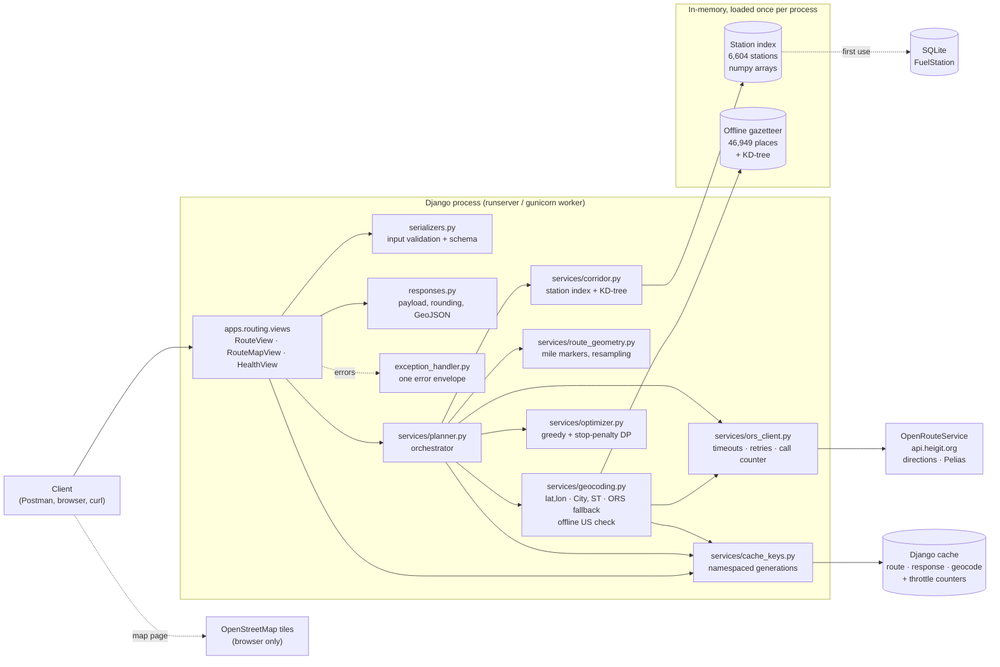
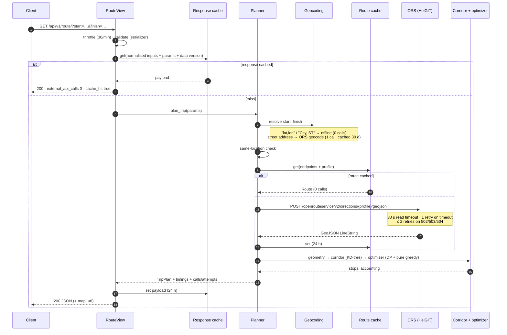
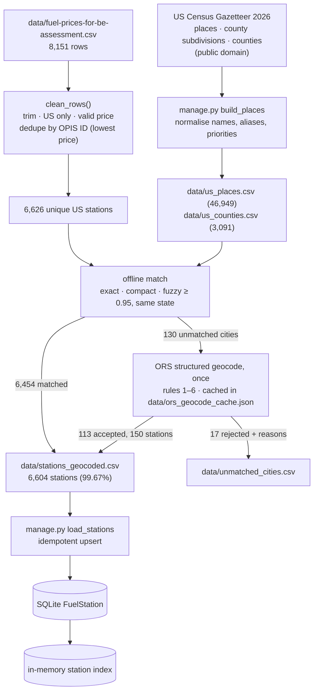

# Architecture

## Components

### Why each layer exists

| Layer | Responsibility | Django-free? |
|---|---|---|
| `views.py` | HTTP only: validate input → call the planner → build the payload; the response cache; throttling via `throttle_scope` | no |
| `serializers.py` | Parameter rules (ranges, `start_fuel` parsing, tank check) and the OpenAPI response schema | no |
| `responses.py` | Turns a `TripPlan` into JSON or map context. All rounding happens here, and only here | settings only |
| `exception_handler.py` | Maps domain errors, validation, throttling and framework errors to `{"error": {code, message, details}}` | no |
| `services/planner.py` | Orchestration: resolve → same-location check → route (route cache) → geometry → corridor → optimizer (penalised and pure). Collects timings and call counts | uses the cache |
| `services/geocoding.py` | Location resolution, the offline "inside the US" check, and the geocode cache | uses the cache |
| `services/ors_client.py` | The only module that talks HTTP to ORS. Converts `[lon, lat]` order, applies timeouts and retries, and maps errors | settings only |
| `services/route_geometry.py` | Polyline → cumulative miles → uniform 0.5-mile resampling | **yes** (numpy) |
| `services/corridor.py` | Station arrays (lazy singleton) and the KD-tree corridor query | **yes**, except the DB loader |
| `services/optimizer.py` | Greedy and DP; pure functions with their own `UnreachableRouteError` | **yes** |
| `apps/stations/` | `FuelStation` model, admin, CSV cleaning, gazetteer, offline and ORS-fallback geocoding, loading commands | partly |

The pure modules (geometry, corridor, optimizer) are unit-tested without Django. Domain exceptions are converted to HTTP in one place.

## Request sequence

`GET /api/v1/route/map/` follows the same path with its own response-cache entry. It reuses the route cache, so opening a `map_url` after the JSON request makes **0** routing calls.

## Caching layers

| Layer | Key | Value | TTL | Saves |
|---|---|---|---|---|
| **Response** (`views.py`) | normalised `start`/`finish` text + every parameter + endpoint kind + station-data version | rendered payload (without `map_url` and timings) | 24 h | everything: geocoding, routing, corridor, DP, serialisation |
| **Route** (`planner.py`) | profile + endpoints rounded to 1e-5° (~1 m) | `Route` (polyline, distance, duration) | 24 h | the ORS directions call, even when vehicle parameters change |
| **Geocode** (`geocoding.py`) | normalised free text | ORS results | 30 days | the ORS geocode call |

- **Backend:** Django's cache framework, configured with `CACHE_URL`. The default is a file cache in `.cache/`, so it survives `runserver` restarts and is shared by gunicorn workers. Tests use LocMem; production would use Redis. `MAX_ENTRIES` is raised from Django's default of 300 to 10,000.
- **Invalidation:** Django can't delete keys by prefix, so each namespace has a **generation counter** stored in the cache and embedded in every key. `manage.py clear_cache` bumps it, which makes all old entries unreachable for every process at once, while leaving throttle counters alone. Counters are created from the clock in nanoseconds and only ever increase, so an evicted counter can't resurrect old entries. That eviction is a real failure mode of the file cache, which culls a random third of its entries when full; it was found by the benchmark ([ADR-010](DESIGN_DECISIONS.md)).

## In-memory data and process model

- **Station index:** 6,604 stations as numpy arrays (price, lat, lon, 3D unit vectors). It's loaded from the database on the first request that needs it, never per request, and never in `AppConfig.ready()`, which also runs during `migrate` and tests.
- **Offline gazetteer:** 46,949 Census places and their KD-tree (about 0.8 s to load; the station index takes about 0.1 s). It's used for `"City, ST"` lookups and the US check.
- Both are thread-safe lazy singletons. `/api/health/` touches both, so one health call warms a process.
- **gunicorn:** `WARM_ON_STARTUP=1` with `--preload` loads both in the master process before forking, so workers share the memory copy-on-write and no request pays the load. DB connections are closed before the fork.

## Data pipeline

Details are in [DATA_PIPELINE.md](DATA_PIPELINE.md).

## Errors

| HTTP | `error.code` | Raised by |
|---|---|---|
| 400 | `invalid_input`, `parse_error`, `bad_request` | serializer, JSON parser, Django request limits |
| 413 | `request_too_large` | body over 2.5 MB |
| 405 | `method_not_allowed` | DRF |
| 422 | `location_not_found`, `location_outside_usa`, `same_location`, `route_unreachable` | geocoding, planner, optimizer gap, ORS 2004/2009/2010 |
| 429 | `rate_limited` | our throttle, or ORS 429 |
| 502 | `routing_provider_error` | other ORS errors |
| 503 | `routing_provider_unavailable`, `station_data_unavailable` | connection errors after retries, bad or missing key, no stations loaded |
| 504 | `routing_provider_timeout` | read timeout after the retry |
